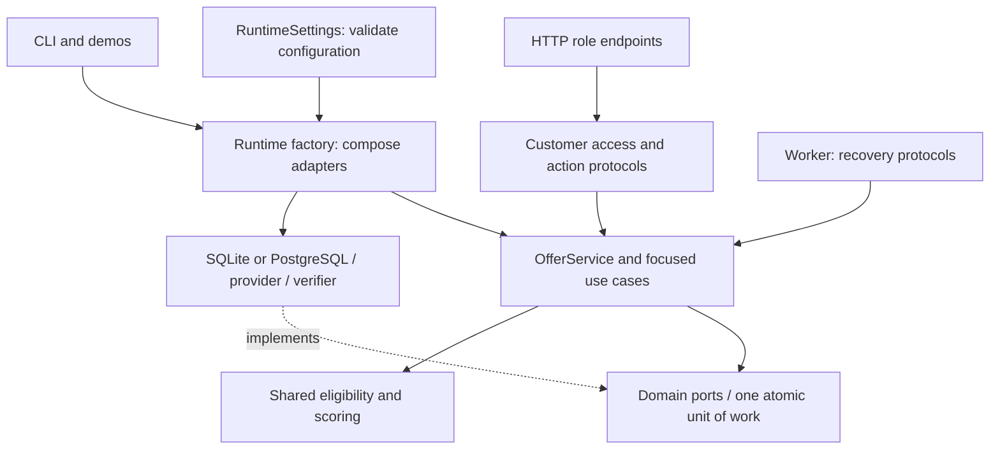

# Architecture and SOLID contracts

Festive Offer Engine keeps financial rules, persistence and recovery responsibilities explicit. Pure eligibility, exact-money calculation, validation and metrics remain functions; a class is used where a value, strategy, repository or runtime dependency benefits from one.

## Responsibilities and dependencies

The batch pipeline coordinates validation, ranking and metrics. The operational facade delegates to publication, trusted inputs, quoting, admission, dispatch, evidence and reporting. Native SQL belongs to the database adapters. HTTP framing, authentication, role endpoints, customer ownership, configuration and process operation have separate responsibilities.

| Principle | Application in this reference |
|---|---|
| Single responsibility | The facade coordinates focused use cases. Authentication does not own routing; role handlers do not own ledger SQL. Database adapters establish snapshots while a common exporter writes files. Evidence readers load data once before pure report section generation. |
| Open/closed | A scorer, provider, verifier or storage adapter is supplied through a protocol. A new adapter does not require editing financial use cases. Explicit selection belongs in the composition factory. A new financial product still requires deliberate domain rules and tests. |
| Liskov substitution | Both stores must preserve atomic reservation, idempotency, usage, outbox, evidence and replay contracts. The same repository contract cases execute on SQLite and isolated PostgreSQL. A provider must reject changed payment bindings under an existing reference, including concurrent submissions. |
| Interface segregation | Freshness policy sees `SnapshotReadPort`; the worker sees recovery actions and work-queue reads. Customer access sees checkout/quote/application lookups. The full unit of work is retained where multiple financial facets must share one transaction. |
| Dependency inversion | Use cases depend on protocols, not SQL drivers, HTTP adapters or configured bearer tokens. Runtime construction injects concrete dependencies. The source-layout check guards these domain import boundaries. |

## Canonical source map

| Responsibility | Canonical modules |
|---|---|
| Values, decoding and pure decisions | [models.py](../src/festive_offers/models.py), [serialization.py](../src/festive_offers/serialization.py), [validation.py](../src/festive_offers/validation.py), [ranking.py](../src/festive_offers/ranking.py), [metrics.py](../src/festive_offers/metrics.py), [pipeline.py](../src/festive_offers/pipeline.py) |
| Operational facade and policies | [offer_service.py](../src/festive_offers/online/offer_service.py), focused `*_service.py` modules, [policy.py](../src/festive_offers/online/policy.py), [ports.py](../src/festive_offers/online/ports.py) |
| Native persistence | [sqlite_store.py](../src/festive_offers/online/sqlite_store.py), [sqlite_repository.py](../src/festive_offers/online/sqlite_repository.py), [postgres_store.py](../src/festive_offers/online/postgres_store.py), [postgres_repository.py](../src/festive_offers/online/postgres_repository.py) |
| Portable operational export | [operational_export.py](../src/festive_offers/online/operational_export.py): table inventory, copied table records, safe artifact names and the completed hash manifest |
| Provider and cloud connection adapters | [fake_provider.py](../src/festive_offers/online/fake_provider.py), [http_provider.py](../src/festive_offers/online/http_provider.py), [security.py](../src/festive_offers/online/security.py), [lakebase.py](../src/festive_offers/online/lakebase.py) |
| HTTP transport and customer boundary | [api.py](../src/festive_offers/online/api.py), [api_models.py](../src/festive_offers/online/api_models.py), [authentication.py](../src/festive_offers/online/authentication.py), [api_routes.py](../src/festive_offers/online/api_routes.py), [api_access.py](../src/festive_offers/online/api_access.py) |
| Configuration, construction and process operation | [runtime_settings.py](../src/festive_offers/online/runtime_settings.py), [runtime_factory.py](../src/festive_offers/online/runtime_factory.py), [runtime_cli.py](../src/festive_offers/online/runtime_cli.py), [worker.py](../src/festive_offers/online/worker.py) |
| Stable launchers and scenarios | [runtime.py](../src/festive_offers/online/runtime.py), [system_demo.py](../src/festive_offers/online/system_demo.py), [runtime_demo.py](../src/festive_offers/online/runtime_demo.py) |

The former `provider.py`, `store.py` and `service.py` paths remain compatibility imports. They re-export the identical `FakeProvider`, `SQLiteStore` and `OfferService` class objects. Existing notebook/readers retain `sign`, `SCHEMA` and `EXPORT_TABLES` imports. Current implementation imports use the descriptive canonical modules; compatibility is checked in [test_repository_contracts.py](../tests/test_repository_contracts.py).

`RuntimeSettings` validates an environment snapshot before opening a database or provider resource. The factory constructs the selected adapters. The CLI starts the server or worker and handles publication/export commands. `runtime.py` preserves the existing launcher and import surface.

## Contracts that extensions must preserve

One unit of work commits related budget, usage, application, outbox, inbox and journal changes together, or rolls all of them back on any `BaseException`. Repository facets share one connection and do not commit independently. Protocol facets are read-only properties: callers cannot replace a repository through the declared interface, while repository methods still perform the authorized transactional mutations. Narrow read views do not create separate financial transactions.

SQLite acquires `BEGIN IMMEDIATE`; PostgreSQL acquires a per-schema advisory transaction lock before exposing the unit. Quote, admission, dispatch and publication timestamps are sampled after lock acquisition. The reference deliberately serializes these units. It does not establish production throughput, and PostgreSQL writers bypassing the lock protocol are outside its guarantees.

Fresh SQLite schemas constrain positive customer limits and nonnegative integer funding/liability amounts. PostgreSQL uses its own typed columns and checks. `CREATE TABLE IF NOT EXISTS` does not migrate existing databases; retained runs keep their original schema and provenance.

A scorer receives nominal integer paise and an exact probability. It returns nonnegative integer expected paise no greater than nominal benefit. It changes the comparison objective, not eligibility or campaign liability. Zero scores are omitted from the recommendation slate. The shipped policy is `expected_savings_v1`; an alternate objective needs a retained strategy/configuration identity and replay evidence before use.

A provider preserves one stable reference and refuses a changed binding. The fake provider now serializes binding checks and event-sequence allocation with their writes. A verifier authenticates normalized evidence; the evidence use case also checks shape, reserved binding and transition validity. The public fixture key authenticates only synthetic local messages. The HTTP adapter is a normalized integration boundary, not a bank or issuer implementation.

The HTTP boundary keeps customer choices separate from merchant facts, operator funding and provider evidence. Ownership reads live in `CustomerOfferAccess`, role parsing in endpoint groups, and credential handling in `TokenAuthenticator`. The worker depends only on expiry, dispatch, reconciliation and bounded queue-read protocols. Neither needs to import a concrete database or the complete service implementation.

## Quote preparation

The publication compiler retains rejected rows and
reasons, hashes the complete approved bundle, and verifies counts and content
again before activation. A content hash checks completeness within a trusted
publication path; it does not authenticate an arbitrary publisher. Merchant
checkouts and verified instrument metadata enter through trusted ingestion.
Wallet ingestion applies duplicate instrument-identity validation before any
wallet is persisted. The application uses a timezone-aware server clock. Quote
expiry is bounded by its TTL, surviving offer end times and the immutable preparation freshness
deadline. Reactivating the same revision does not refresh its source age.

## Payment and benefit lifecycle

**Durable identities.** An exact idempotency-key retry returns the saved
application; a changed fingerprint is refused. Permanent unique merchant payment
and checkout identities prevent another key from awarding the same purchase
again, including after delivery, failure and process restart. Failed applications
retain their identity rather than silently creating a replacement payment.

**Dispatch and worker progress.** Each worker cycle expires undispatched READY
holds, reads a bounded READY batch and invokes guarded dispatch. The application
and outbox claim commit before the provider call, which runs outside the database
transaction. A timeout or crash after claim keeps liability held. An absent
provider observation is not evidence that an in-flight payment failed.

The worker depends only on `RecoveryActions` and work-queue read protocols. It
then reconciles a bounded page of DISPATCHING, PENDING, UNKNOWN or
benefit-OWED applications by their original provider reference. Its recovery
cursor advances through application identifiers and wraps after the last page,
so one unresolved early item does not monopolize a running worker's batch. The
cursor is in memory: a process restart begins a new pass over durable database
work. This is a reference polling worker, without a distributed lease or a
guaranteed recovery latency. Multiple callers still recheck state in the
transactional use case before attempting a dispatch.

**Evidence and qualification.** The normalized event contract checks identity,
sequence, shape and the full reserved payment binding: merchant, currency,
amount, verified instrument/product/network/mode, checkout and basket fingerprint.
Instant discount charges basket minus discount; cashback charges the full
basket. Partial or inconsistent evidence retains funds for reconciliation. The
public HMAC key belongs only to the local fake fixture. The HTTP provider mode
requires a separately configured event key. Checkout/basket metadata is a
trusted merchant/provider-adapter contract; the code does not establish native
PSP line-item evidence.

**Benefit delivery.** Qualifying capture commits held funding/usage and creates
one durable `OWED` obligation. Separate matching cashback or instant-discount
evidence marks delivery `FULFILLED`; capture alone does not confirm cashback.
Identical messages do not repeat transitions. Early valid benefit receipts defer
until capture is established, and original-reference lookup returns payment and
benefit history to recover lost or reordered callbacks.

**Failure and review.** Definitive failure releases held funding and usage once.
Stale or conflicting evidence cannot undo committed benefit funding or re-award
a released application. Refunds and inconsistent bindings remain explicit review
cases; later delivery evidence does not erase those review flags. No automatic
refund settlement or usage-limit reset is implemented.

**Export and replay.** Journal events accompany the financial changes they
describe. Reports rebuild held/committed amounts from those events and compare
them with native budget rows. Each store exports all 13 operational tables to
JSON/CSV through the shared `operational_export.py` format and writes the hash
manifest last. SQLite copies rows in one serialized transaction; PostgreSQL also
takes shared table locks while reading its complete table set. Both release
database locks before the common filesystem writer runs. It rejects unsafe report
paths and report names that would overwrite a table or manifest. Reports are
obtained before export and declare that separate scope;
they are not asserted to share an atomic snapshot with the exported tables.

## Integration and verification boundaries

The [runtime guide](runtime.md) covers role credentials, customer ownership, the worker and provider configuration. The [Databricks guide](databricks.md) covers publication jobs, batch export import and the optional Lakebase connector. These define deployment boundaries; local execution does not establish cloud privileges, managed sync, actual partner evidence or production throughput.

[Current verification](quality-2026-11-08/readme.md) records exact tests and observed scope. Historical result captures retain their own counts and source identities.
