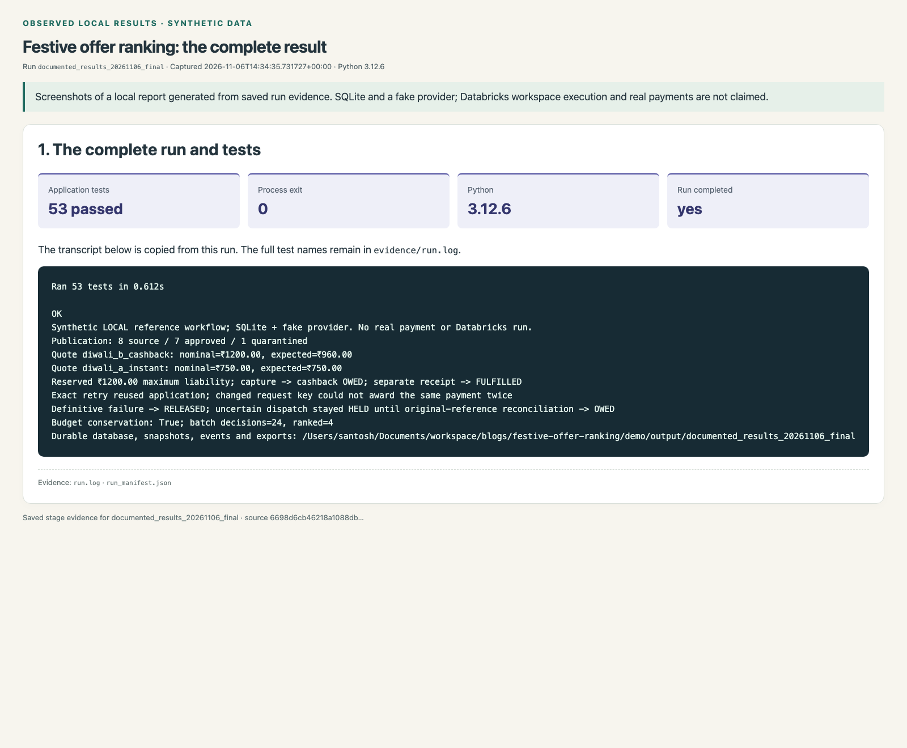
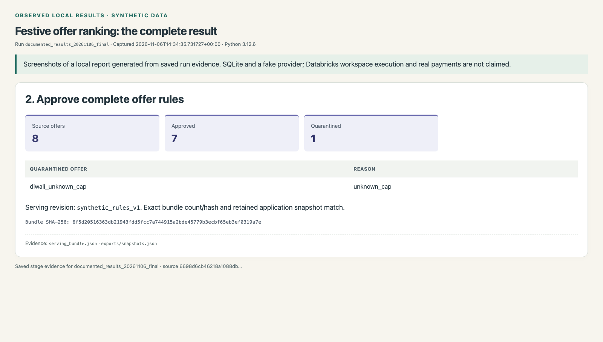
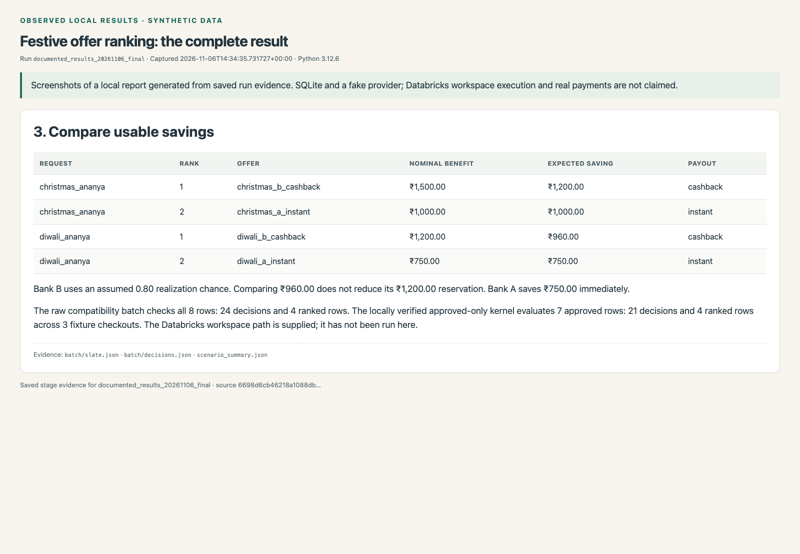
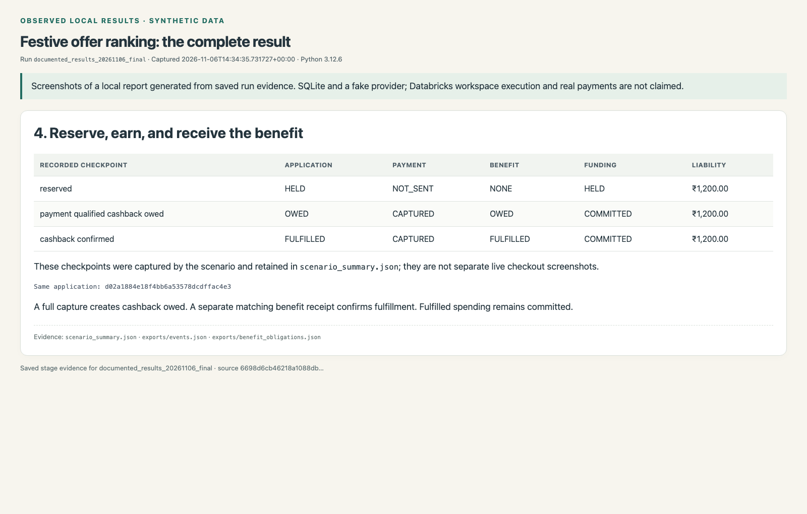
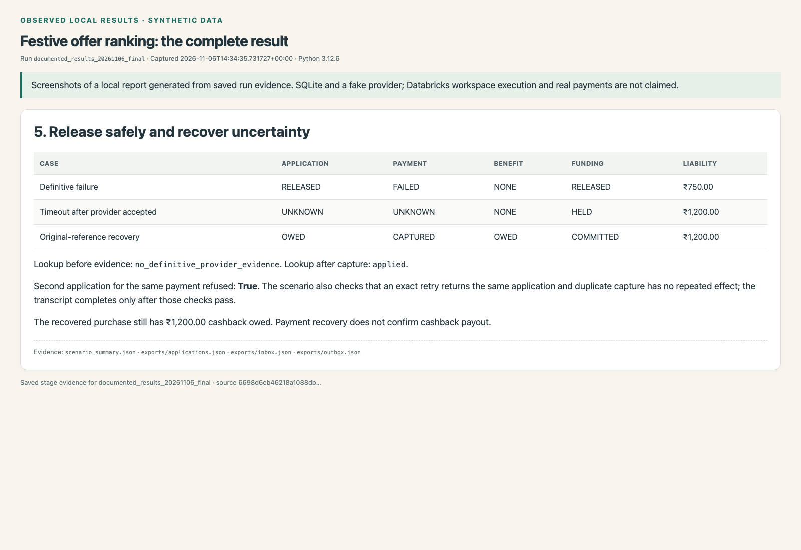
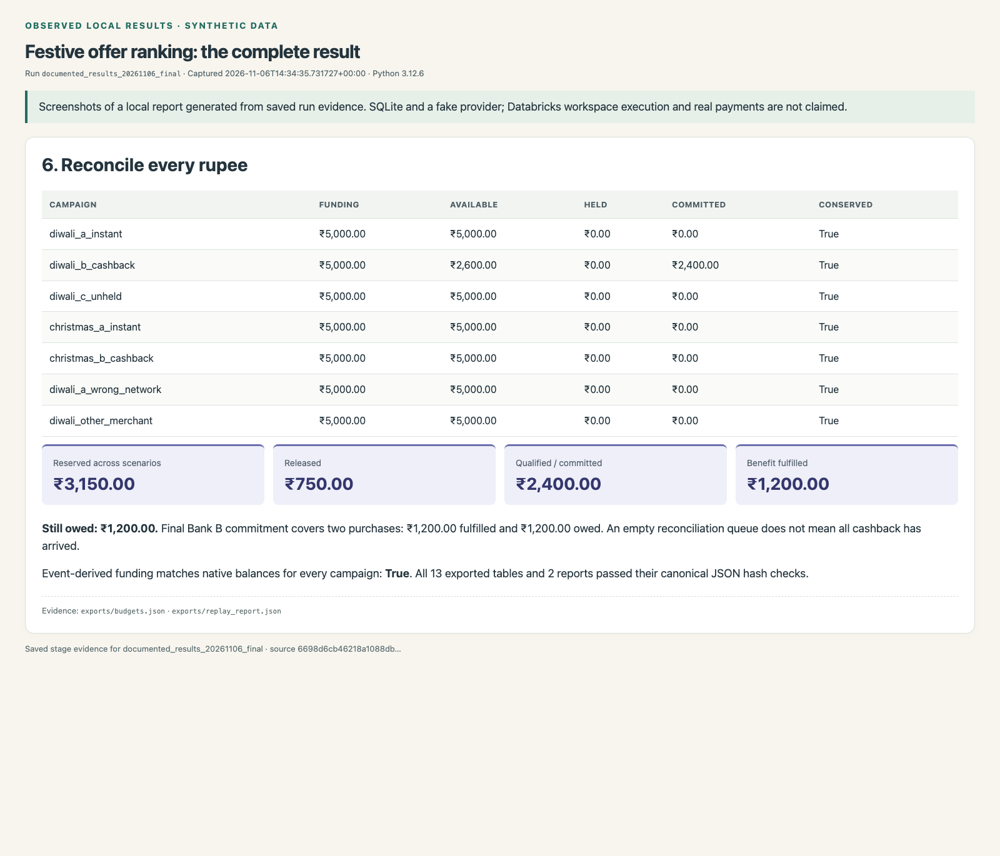
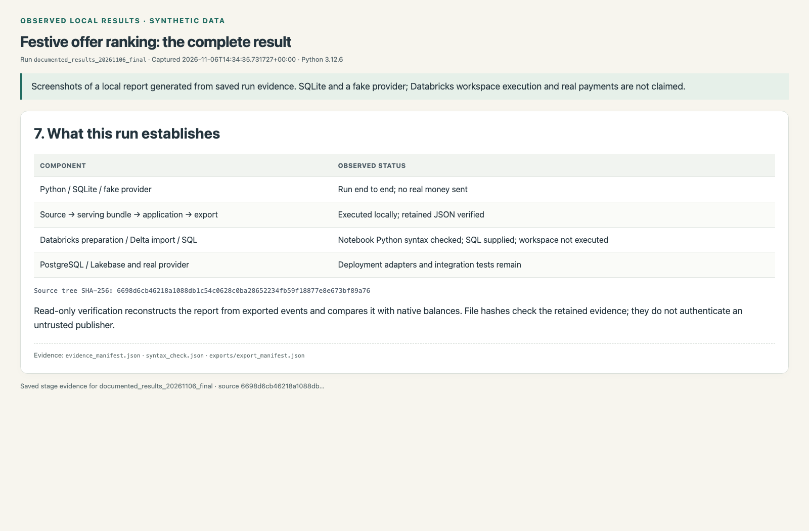

# Observed end-to-end results

This record comes from one executed synthetic local run. It covers source validation, publication, ranking, reservation, simulated payment, separate cashback confirmation, failure/recovery, and analytical export. Screenshots show a report of retained data, rather than a Databricks or live-payment interface.

**Run:** `documented_results_20261106_final`. **Captured:** 2026-11-06T14:34:35.731727+00:00. **Runtime:** Python 3.12.6. **Application tests:** 53 passed; process exit 0.

[Open the complete HTML report](index.html) · [Full test/run transcript](evidence/run.log) · [Evidence manifest](evidence/evidence_manifest.json) · [Source code and SOLID boundaries](../architecture.md)

## Reproduce and verify

This is a retained 6 November capture from before the standalone repository was
created. Its runtime values and source identities describe that historical run.

From the repository root:

```bash
./record_results.sh --run-id my_results_01 --destination docs/my-results/evidence --snapshots
./record_results.sh --verify-run output/my_results_01
./record_results.sh --verify-run docs/my-results/evidence
```

Use a new run ID and destination for each capture. The recorder refuses an existing run; `--replace` replaces only a results evidence destination. Screenshot generation needs a local Chromium-based browser; the application and evidence verifier use the Python standard library. The recorder checks source identity before and after execution.

To verify the saved application run used here: `./record_results.sh --verify-run docs/results/evidence`. This reads exported JSON, checks the completion and content hashes, and reconstructs ledger totals from events without sending a payment or modifying the database.

The checked-in evidence is portable. Its manifest hashes bind the copied files to this capture. If the ignored original output directory is absent, retain the evidence folder and its manifest together; the read-only verification command also accepts that evidence folder. To regenerate only screenshots from retained views, use `python3 -m tools.capture_snapshots --results docs/my-results --replace`.

## Reading the result

- Publication approves 7 of 8 source offers. The missing-cap row is quarantined.
- Bank B ranks first at ₹960.00 expected savings from ₹1,200.00 nominal cashback. Applying it reserves the full ₹1,200.00. Bank A saves ₹750.00 immediately.
- The primary application moves from HELD to cashback OWED, then to FULFILLED only after separate evidence.
- A ₹750.00 failed-payment hold is released. A separate ₹1,200.00 uncertain attempt stays held until original-reference reconciliation establishes capture; its cashback remains OWED.
- Final Bank B funding is ₹5,000.00 = ₹2,600.00 available + ₹0.00 held + ₹2,400.00 committed. Committed funding covers the fulfilled purchase and the still-owed purchase.
- Replay totals across the scenarios are ₹3,150.00 reserved, ₹750.00 released, ₹2,400.00 qualified, and ₹1,200.00 fulfilled. Fulfillment does not make that spent funding available again.

The 24 raw batch decisions and 4 ranked rows include the incomplete contract refusal. The locally verified approved-only path has 21 decisions across 3 fixture checkouts and 4 ranked rows. Synthetic scoring probabilities and amounts are not production measurements.

## Snapshots and raw evidence

### 1. The complete run and tests



[Standalone rendered view](views/01-run-and-tests.html). Raw evidence: [run.log](evidence/run.log), [run_manifest.json](evidence/run_manifest.json).

### 2. Approve complete offer rules



[Standalone rendered view](views/02-publication.html). Raw evidence: [serving_bundle.json](evidence/serving_bundle.json), [exports/snapshots.json](evidence/exports/snapshots.json).

### 3. Compare usable savings



[Standalone rendered view](views/03-offer-ranking.html). Raw evidence: [batch/slate.json](evidence/batch/slate.json), [batch/decisions.json](evidence/batch/decisions.json), [scenario_summary.json](evidence/scenario_summary.json).

### 4. Reserve, earn, and receive the benefit



[Standalone rendered view](views/04-benefit-lifecycle.html). Raw evidence: [scenario_summary.json](evidence/scenario_summary.json), [exports/events.json](evidence/exports/events.json), [exports/benefit_obligations.json](evidence/exports/benefit_obligations.json).

### 5. Release safely and recover uncertainty



[Standalone rendered view](views/05-failure-and-recovery.html). Raw evidence: [scenario_summary.json](evidence/scenario_summary.json), [exports/applications.json](evidence/exports/applications.json), [exports/inbox.json](evidence/exports/inbox.json), [exports/outbox.json](evidence/exports/outbox.json).

### 6. Reconcile every rupee



[Standalone rendered view](views/06-ledger-and-replay.html). Raw evidence: [exports/budgets.json](evidence/exports/budgets.json), [exports/replay_report.json](evidence/exports/replay_report.json).

### 7. What this run establishes



[Standalone rendered view](views/07-execution-boundary.html). Raw evidence: [evidence_manifest.json](evidence/evidence_manifest.json), [syntax_check.json](evidence/syntax_check.json), [exports/export_manifest.json](evidence/exports/export_manifest.json).

## Execution boundaries

The SQLite service and durable fake provider were executed locally. Databricks notebook Python passed syntax checks; SQL is supplied. Neither cloud path has been executed in a workspace. PostgreSQL/Lakebase, service deployment/authentication, and real issuer/provider integration remain separate work. [Follow the cloud handoff steps](../databricks.md).

The [render manifest](render_manifest.json) binds each view to this evidence set. A snapshot manifest records the run ID, each standalone HTML hash, PNG hash, browser version, viewport, and capture command. [Snapshot manifest](snapshots/snapshot_manifest.json). A screenshot is a reading aid; the JSON, transcript, source digest, and read-only replay are the reproducible evidence.

All inputs, wallets, payment events, and amounts are synthetic. The public fixture signing key is not a credential. Hashes establish internal file integrity and do not authenticate an untrusted publisher.

## Documentation layout update

The guide filename and navigation links were updated to lowercase on 8 November 2026. Raw run evidence, captured view HTML and screenshot bytes are unchanged. The [original index and manifests](archive/) preserve their previous byte identities; the current manifests explicitly record this navigation-only migration.
